# Approve, Refer or Decline? A profit-optimal credit policy

**A consumer lender approves every application its process passes. About 1 in 12 of those loans defaults
within a year and wipes out the margin on the rest.** This project builds the decision layer that sits on top:
a scorecard that predicts 12-month default, unit economics measured from real repayments, and a policy that
chooses **approve, refer to an underwriter, or decline** for every applicant, with a reason code for every
"no".

On **81,464 loans the model never saw** (issued Jan–Jun 2025, €155M lent), the policy **raises realised profit
from €2.0M to €4.7M** and cuts the default rate of approved loans **from 8.1 % to 4.7 %**, while still
approving 70 % of applicants.

| | |
|---|---|
| **Data** | 789,144 real consumer loans, 2009 → Jun 2026, Bondora / Go & Grow public loan book (EE, FI, NL, LV, DK) |
| **Model** | Monotone WoE scorecard (champion) vs. gradient boosting (challenger) |
| **Out-of-time AUC** | 0.730 scorecard · 0.721 gradient boosting · 0.689 lender's own grade |
| **Policy** | Approve 69.6 % · Refer 8.0 % · Decline 22.4 % |
| **Profit (test window)** | €2.0M → **€4.7M** (+€2.7M; €2.1M of it from declines alone) |
| **Deliverables** | [executed notebook](notebooks/credit_policy.ipynb) · [Streamlit simulator](app/streamlit_app.py) · [leakage log](reports/leakage_log.csv) · [JSON scorecard](artifacts/scorecard.json) |

---

## 1. Why this problem exists: price does not follow risk

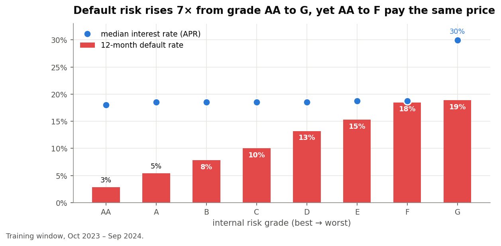

The lender's internal grades separate risk well: 3 % of AA borrowers default within a year, against 19 % of
grade G. **But grades AA to F all pay ≈ 18 % APR.** A grade-F borrower pays the same as a grade-AA borrower
while defaulting 7× as often. When price doesn't absorb risk, the approval decision has to. That is the
business case for everything that follows.

## 2. The data, and the split that keeps the evaluation honest

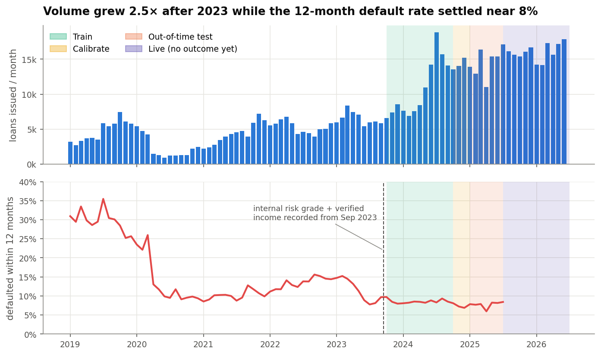

The dataset is the lender's full public loan book. For every loan it holds both the application fields
*and* the cash that came back: principal, interest, fees and default dates. Two facts drove the design:

* The internal grade and verified income only exist **from Sep 2023**, so modelling starts in Oct 2023.
* The target (*default within 12 months on book*) needs 12 months to mature. Loans issued after Jun 2025
  have no outcome yet, so they become the **live population** for drift monitoring.

| Window | Issued | Loans | Used for |
|---|---|---|---|
| Train | Oct 2023 – Sep 2024 | 121,684 | binning, scorecard, gradient boosting |
| Calibrate | Oct – Dec 2024 | 41,119 | tuning, calibration, **choosing the cut-off** |
| Out-of-time test | Jan – Jun 2025 | 81,464 | every performance number reported |
| Live | Jul 2025 – Jun 2026 | 184,508 | drift (no labels yet) |

Excluded: 14-day cooling-off withdrawals (19k: not credit decisions) and loans without a grade.

## 3. Leakage log: 31 columns, 7 usable

Every column was classified by one question: **would this value exist at the moment of the decision?**
Twenty columns fail it: payments received, days past due, months on book, current status. The proof that
this matters:

| Feature set | Out-of-time AUC |
|---|---|
| 5 honest application fields | 0.685 |
| + 4 "innocent" servicing columns (`months_on_book`, `interest_paid_total`, …) | **0.995** ← a leak, not a model |
| + `projected_npv_return` (lender's pricing-model output, timestamp undocumented) | 0.653, so excluded |

The full log with a rationale for each column is in [`reports/leakage_log.csv`](reports/leakage_log.csv).
Rule applied: **if a field's timestamp cannot be proven, it stays out.**

## 4. What a loan is actually worth

Instead of assuming a loss-given-default, I measured it. On the 2021–22 cohorts (3.5–5 years of repayment
history, similar pricing to today), the net cash return per € lent is:

| Outcome at 12 months | Lifetime cash return | 2021 cohort | 2022 cohort |
|---|---|---|---|
| Performing | **+21 %** | +20.9 % | +21.0 % |
| Defaulted | **−57 %** | −55.7 % | −58.9 % |

"Performing at 12 months" already includes the loans that default *later*, so the 12-month model and
lifetime money stay consistent. After a 6 % cost of funds (charged on principal-years recovered from
interest paid ÷ rate) and 2 % opex, each term gets its own break-even default probability:

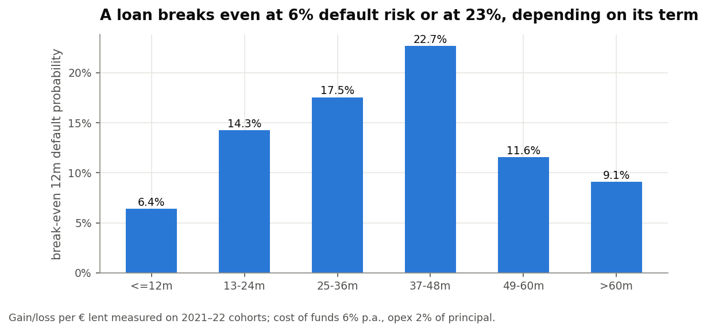

**A 12-month loan stops paying at 6 % default risk; a 3–4-year loan can absorb 23 %.** A single score cut-off
therefore cannot be optimal for every product. This became the most important design decision in the
policy.

## 5. Scorecard vs gradient boosting: complexity has to earn its place

**Model A, the scorecard.** Each feature is binned (up to 20 quantile bins), adjacent bins are merged until
the bad rate is monotone, WoE is computed, collinear features are dropped (|ρ| > 0.6), and the remaining
features go into a logistic regression scaled to points (600 = 50:1 odds, 20 points to double the odds). Five
characteristics survive: **grade, country, loan term, loan-to-income, income**.

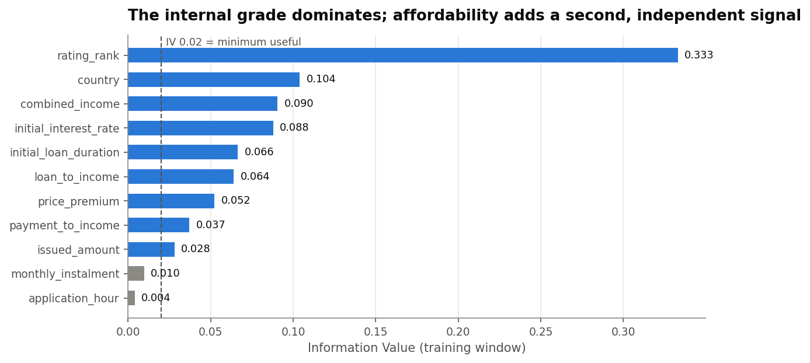

**Model B, gradient boosting** (scikit-learn's histogram GBM, the LightGBM-style algorithm). It uses all 11
features, native categoricals, and monotone constraints on grade and payment-to-income. Twelve
configurations were tuned on the calibration window, from 4 to 31 leaves.

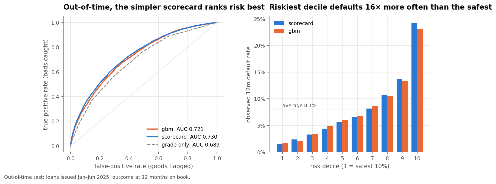

| Out-of-time (Jan–Jun 2025) | AUC | Gini | KS | Brier |
|---|---|---|---|---|
| **Scorecard** | **0.730** | **0.460** | **0.334** | **0.0693** |
| Gradient boosting | 0.721 | 0.442 | 0.324 | 0.0699 |
| Lender's grade alone | 0.689 | 0.378 | 0.270 | – |

I expected the GBM to win. **It lost, and the gap is significant** (paired bootstrap: −0.009, 95 % CI −0.012
to −0.007). With a few application fields and a product mix that shifts quickly, monotone bins generalise
better than learned interactions. The scorecard is also auditable and gives exact reason codes, so it is
the champion. The riskiest decile defaults **16× more often** than the safest.

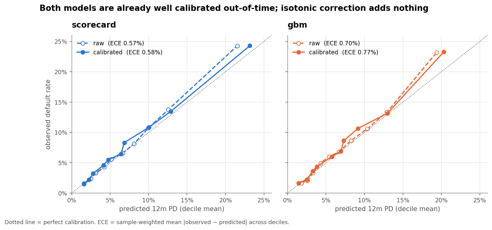

Both models are calibrated out-of-time (expected calibration error 0.6 pp). Isotonic recalibration added
nothing, so the policy uses the scorecard's own PD.

## 6. The profit curve: where to draw the line

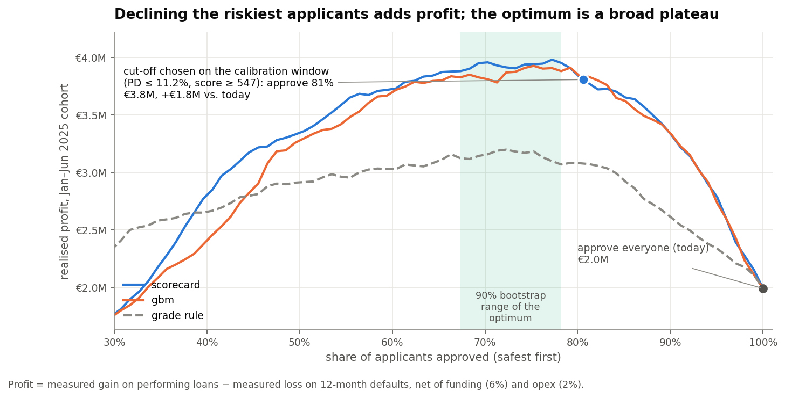

Sort applicants from safest to riskiest, approve the top *x %*, and add up what each approved loan actually
made or lost. The cut-off is **chosen on the calibration window** and only evaluated on the test window.

| Policy (evaluated on Jan–Jun 2025) | Approve | Bad rate | Profit | vs. today |
|---|---|---|---|---|
| Approve everyone (today) | 100 % | 8.1 % | €2.0M | – |
| Single cut-off **PD ≤ 11.2 % / score ≥ 547** | 81 % | 5.4 % | €3.8M | +€1.8M |
| Term-aware rule: approve if expected € > 0 | 75 % | 5.0 % | €4.1M | +€2.1M |
| *Hindsight-best single cut-off (for reference)* | *77 %* | *5.1 %* | *€4.0M* | *+€2.0M* |
| **Approve / Refer / Decline (final)** | **70 % + 8 % refer** | **4.7 %** | **€4.7M** | **+€2.7M** |

Two things stand out. First, the term-aware rule has **no tuned threshold at all**, yet it beats the
hindsight-best single cut-off, because break-even differs by term. Second, the optimum is a **plateau**: in
90 % of bootstrap resamples the best approval rate lands between 67 % and 78 %. Exact precision about the
cut-off is worth little, and that flat region is where human review pays.

## 7. Approve, Refer or Decline

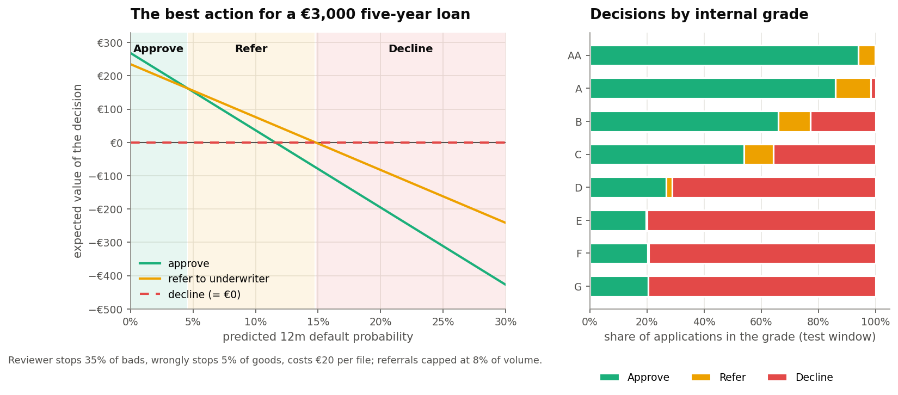

Each applicant gets the action with the highest expected value:

```
Approve  = (1 − PD)·G − PD·L
Refer    = (1 − PD)·(1 − f)·G − PD·(1 − c)·L − review cost     (reviewer stops c of bads, f of goods)
Decline  = 0
```

With c = 35 %, f = 5 % and €20 per review, a refer band **emerges by itself** around break-even. It is widest
for large loans, where a review protects the most money. Referrals average **€7.5k** against €1.2k for
approvals, and are capped at 8 % of volume to match underwriting capacity. The policy is not "decline grades
E–G": it still approves ~20 % of them (small 1–4-year loans) and declines ~23 % of grade B (mostly long, high
loan-to-income loans).

To be explicit about what is measured and what is assumed: **€2.1M of the €2.7M uplift comes from declines
alone**, which depend only on the model and the measured economics. The ~€0.6M from referrals depends on
reviewer effectiveness, which a pilot should measure first.

## 8. Sensitivity: how wrong can the assumptions be?

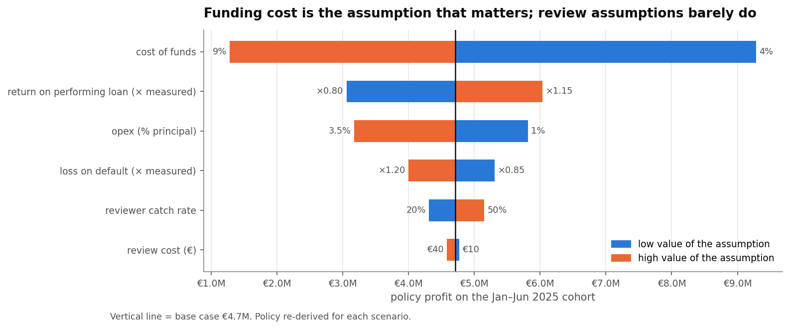

Each assumption was moved to a pessimistic and an optimistic value, and the policy re-derived. I also
measured the **regret**: the profit lost by keeping the base policy when the world turns out different.

* **Cost of funds is the only assumption that matters.** At 9 % the right policy approves just 30 %, and
  keeping the base policy would leave €2.8M on the table. It is the input to agree with Treasury.
* Every other assumption (opex, loss severity, return, review cost and catch rate) carries a regret under
  €0.16M. The policy is robust to them.
* **The policy works as insurance.** If defaults run 50 % above expectation, approving everyone loses €1.5M,
  while the policy still earns €3.6M. Its value rises from €2.0M to €5.1M exactly when it is needed.

## 9. Reason codes for every decline

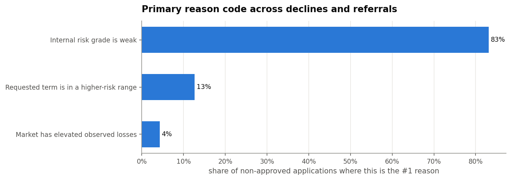

EU consumer-credit rules and the GDPR give a declined applicant the right to know why. With a scorecard the
explanation *is* the model: for each characteristic, count the points lost against the best attribute, and
report the largest shortfalls. No SHAP, no surrogate model. A real declined applicant from the test window:

> **Grade E · Latvia · €432 over 60 months · income €677/month · score 496 · PD 42 %**
> 1. Internal risk grade is weak: grade E (−47 pts)
> 2. Market has elevated observed losses: Latvia (−43 pts)
> 3. Requested term is in a higher-risk range: 60-month term (−22 pts)

## 10. Drift and segment checks

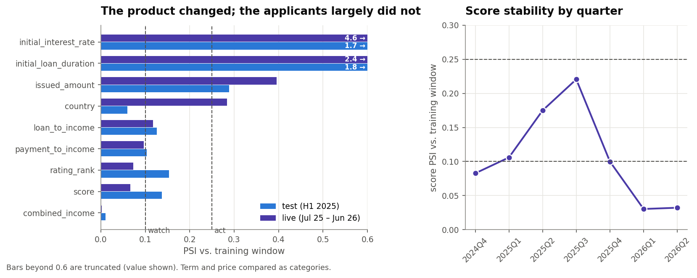

* The **score is stable on live data** (PSI 0.07). It briefly drifted into the "investigate" zone in
  mid-2025 (peak 0.22) and came back.
* **The product changed, not the applicants.** Loans over 60 months went from 3 % of training to 53 % of the
  live book (84- and 120-month terms), and pricing collapsed to almost a single rate. Calibration on those
  long loans still held out-of-time (7.1 % predicted vs 7.2 % observed). The action is to **re-measure their
  economics as they season**, not to rebuild the model.

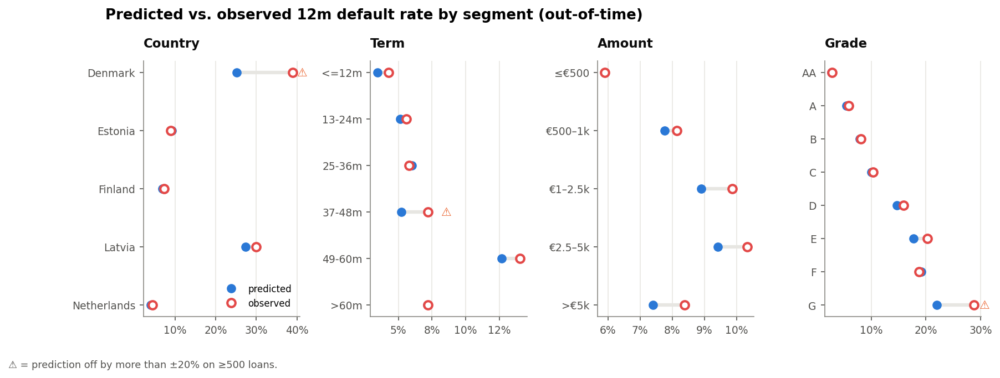

* Calibration holds within ±13 % for every large segment (Finland, Estonia, Netherlands, every amount band,
  grades AA–F).
* **Denmark** is under-predicted (25 % vs 39 %). It launched after the training window, so the scorecard
  treats it as an unseen market. The fix is governance, not modelling: **refer Danish applications under a
  volume cap until 12 months of outcomes exist.**
* No protected attributes are in the data, so a direct fairness audit is not possible. `country` (market of
  residence) is the feature closest to a sensitive attribute and is flagged for compliance review.

## 11. Streamlit simulator

`streamlit run app/streamlit_app.py`

* **Portfolio impact.** Move the cost of funds, loss severity, review cost and effectiveness, underwriting
  capacity, or a downturn stress, and watch the approve/refer/decline mix, the profit curve and the bad rate
  respond on the 81k test loans. You can switch between the term-aware rule and a single score cut-off.
* **Score an applicant.** Enter grade, country, amount, term and income to get the score, PD, expected
  profit, decision, points breakdown and reason codes. It is scored from `artifacts/scorecard.json` alone.
* **Segments** and a **drift monitor** (quarterly score PSI, live feature PSI).

The simulator imports the same `src/credit.py` as the notebook, so what you simulate is exactly the policy
that was analysed. Its base case reproduces the notebook (€4.71M, 69.6 / 8.0 / 22.4 %).

## What I would do next

1. **Pilot** the policy as a challenger on 10–20 % of traffic, and record underwriter outcomes in the refer
   band to replace the two reviewer assumptions with measured values.
2. **Selection bias.** Every loan here was approved by the incumbent, so this policy can only *tighten*.
   Learning whether today's declines are profitable needs a small random test-and-learn approval budget or
   reject inference.
3. **Risk-based pricing.** Grades AA–F pay the same price. Pricing for risk would turn part of the 22 %
   declines into profitable approvals, a bigger lever than any model improvement.
4. **Monthly monitoring:** score and feature PSI, predicted vs observed default rate by vintage, decision mix,
   refer outcomes, and the cost of funds feeding the policy.

## Run it

```bash
pip install -r requirements.txt
# 1. download the loan book (≈160 MB) from https://goandgrow.eu/en/public-statistics/
#    → "Loan Dataset" (loan_dataset_investor.xlsx) and place it in the project root
# 2. run the analysis (first run converts the Excel file once, ~2 min)
jupyter notebook notebooks/credit_policy.ipynb
# 3. launch the simulator (uses the saved artifacts, no raw data needed)
streamlit run app/streamlit_app.py
# 4. tests
pytest -q
```

```
credit-policy/
├── notebooks/
│   ├── credit_policy.ipynb   ← executed notebook, all outputs saved
│   └── credit_policy.py      ← same notebook as a reviewable percent-format script
├── src/credit.py             ← features, WoE binning, scorecard, reason codes, economics, decision rule, PSI
├── app/streamlit_app.py      ← policy simulator
├── artifacts/                ← scorecard.json, policy.json, scored test & live sets
├── reports/                  ← leakage log, model / policy comparison, sensitivity, PSI, segment checks (CSV)
├── figures/                  ← every chart in this README
├── tests/test_credit.py      ← unit tests incl. JSON-scorecard parity
└── tools/run_notebook.py     ← headless notebook executor
```

**Data source:** Bondora / Go & Grow public loan dataset (downloaded 1 Oct 2026). The data is anonymised and
published by the lender for investors. This is an independent analysis, not affiliated with Bondora.
**Limitations:** approved-loan population only (no reject inference); unit economics for >60-month loans
rest on 2,782 older loans; reviewer effectiveness is assumed; no protected attributes for fairness testing.
